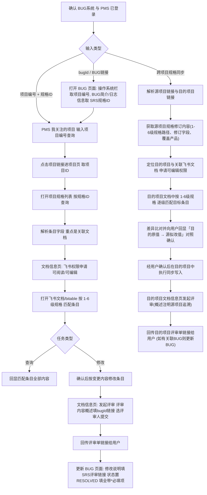

# SRS 规格管理助手（查询、修改与跨项目同步）

围绕 PMS「项目规格」条目与关联的飞书文档，完成 SRS 规格的定位、查询、修改、跨项目同步与评审提交。全程在集成浏览器中操作。

## 系统与登录

| 系统 | URL | 用途 |
|---|---|---|
| BUG 系统 | http://bugs.ruijie.com.cn/ | 由 bugId 解析项目编号与 SRS 规格ID |
| PMS 系统 | http://pms.ruijie.com.cn/ | 检索规格条目、申请飞书权限、发起评审 |

## 何时使用

1. **BUG 定位**：给了 bugId 或 BUG 链接，要查找/修改其对应的 SRS 规格。
2. **直接查询**：给了项目编号 + SRS 规格ID，要查看规格条目内容。
3. **直接修改**：给了项目编号 + SRS 规格ID + 变更内容，要修改规格并发起评审。
4. **跨项目规格同步**：给了源项目链接，要将源项目的 SRS 规格修订内容同步到目的项目对应的 1~6 级规格条目中。

## 输入模式与步骤起点

| 输入 | 执行路径 |
|---|---|
| bugId / BUG 链接 | 步骤 1 → 2 → 3 → 4 → 5 → 6 |
| 项目编号 + 规格ID（查询） | 步骤 1 → 3 → 4(可阅读) → 5(查询) |
| 项目编号 + 规格ID + 变更内容 | 步骤 1 → 3 → 4(可编辑) → 5(修改+提交) → 6 |
| 原项目链接/6级规格 | 步骤 1 → 7(跨项目规格同步流程) |

## 完整流程

## 步骤

### 1. 确认系统登录权限

- 依次打开 http://bugs.ruijie.com.cn/ 与 http://pms.ruijie.com.cn/，判断是否落在登录页。
- 需要登录时提醒用户在集成浏览器中完成登录，**等待登录完成后**再继续；不代填账号密码。
- 两个系统均确认已登录后才进入后续步骤。

### 2. 由 bugId 获取项目编号与 SRS 规格ID（仅 BUG 定位模式）

1. 打开 BUG 页面：用户给了链接就直接打开；只给了 bugId 时拼
   `http://bugs.ruijie.com.cn/bug_switch/bug/main?bugId=<bugId>`。
2. 从 BUG 页面提取两个关键信息：
   - **项目编号**：`操作系统:` 这一栏里填写的内容。
   - **SRS 规格ID**：在 `BUG简介:` 或 `日志信息` 中获取需要修改的规格 ID
     （两处都查找；两处内容不一致时停下向用户确认，不要自行取舍）。
3. 把「项目编号 + 规格ID」回显给用户确认后，进入步骤 3。

### 3. 在 PMS 中查找 SRS 规格条目

1. 打开「我关注的项目」：
   `http://pms.ruijie.com.cn/pms/index.jhtml?taskType=open_url&taskTarget=OPEN_URL&taskTitle=我关注的项目&taskUrl=/project/my_list.jhtml?TYPE=LITE`
2. 在项目搜索栏输入 `<项目编号>`，点击查询。
3. 点击项目栏中的项目链接，跳转到项目页（URL 形如
   `http://pms.ruijie.com.cn/pms/index.jhtml?taskType=open_url&taskTarget=OPEN_URL&taskTitle=<项目编号>&taskUrl=/project/project_index.jhtml?projectId=<项目ID>`），
   记下 **项目ID**。
4. 打开「项目规格」列表：
   `http://pms.ruijie.com.cn/pms/index.jhtml?taskType=open_url&taskTarget=OPEN_URL&taskTitle=项目规格&taskUrl=/project/project_product_standard/project_product_standard_list.jhtml?projectId=<项目ID>`
5. 在 `规格ID:` 栏输入 `<SRS规格ID>`，点击查询。
6. 读取并解析命中的条目，记录下列字段（字段名以页面为准）：

   | 字段 | 用途 |
   |---|---|
   | 规格Id | 条目唯一标识 |
   | 1级规格 ~ 6级规格 | 层级路径，步骤 5 在飞书文档中定位条目的依据 |
   | 规格库 | 所属规格库 |
   | 关联ITC编号 | 关联 ITC 用例编号 |
   | 类型 | 条目类型 |
   | AI检查结果 | AI 检查状态 |
   | 代码变化 | 代码变化标记 |
   | 关联文档 | **飞书文档入口，步骤 4/5 必用** |
   | 数据表 | 关联数据表 |
   | 关联项目需求 | 关联需求 |
   | 关联工作包 | 关联工作包 |
   | 创建时间 / 修改时间 | 时间戳 |

### 4. 飞书文档权限确认

1. 在 `关联文档` 列点击文档链接前的 `[xxx]` id 地址信息，跳转到 `文档信息` 页面。
2. 点击 `飞书权限申请`，在 `申请权限` 栏按任务类型选择后点 `保存`：
   - 查询任务 → 选 `可阅读`。
   - 修改任务 → 选 `可编辑`。
3. `可编辑` 注意：提交负责人非本人时，需**等待提交负责人审核通过**后才有编辑权限；告知用户并等待，不得跳过。
4. 权限最小化：只查询不修改时只申请 `可阅读`。

### 5. 查询、修改、提交文档内容

- **查询**：在 `文档信息` 页面点击 `打开飞书文档` 按钮跳转飞书文档 → 用条目的
  1~6 级规格逐级匹配 → 读取匹配条目的**所有内容**并回显。
- **修改**：在飞书文档中根据用户要求的变更内容修改条目。落笔前先回显
  「原文 → 拟改后」对照，经用户确认再修改。
- **提交**：回到 `文档信息` 页面 → 点击 `发起/查看评审` 进入评审表单申请页 →
  1. **评审内容概述**：必须填写关联的 bugId 链接
     （形如 `http://bugs.ruijie.com.cn/bug_switch/bug/main?bugId=<bugId>`）。
  2. **评审人员**：按项目历史评审惯例为每个必须评审角色（need=1 的角色 chip，
     如 CA/PGTTL/PGTTM/PTGTTL/PTGTTM/PSDPE）选定人员；同一人可兼任多角色，
     角色覆盖人数会累加显示，属正常现象。
  3. **提交**：触发提交；提交成功后页面可能无跳转，不要误判失败——通过
     重新加载文档信息页确认「第 N 次评审」与新表单号（形如 `RF2026xxxxxxxx`），
     或用评审列表接口查 `reviewFormId`，评审单链接形如
     `http://pms.ruijie.com.cn/review/form/flow.jhtml?id=<reviewFormId>`。
  4. **把评审单链接发给用户**，并进入步骤 6。

### 6. 更新 BUG 页面内容并置为 RESOLVED（修改类任务必做）

1. **更新bug状态**：SRS 修订提交评审后，回到 BUG 编辑页
`http://bugs.ruijie.com.cn/bug_switch/bug/bug_info?bugId=<bugId>`将*BUG状态:更新为 RESOLVED 并填全带 \* 必填项：

2. **更新bug内容**：
- **SRS 文档提交链接**：写入 BUG 内容/解决方案/验证字段（如评审单 RF 单号
   与 `flow.jhtml` 链接），确保测试与负责人能从 BUG 页面跳转到 SRS 评审。
- 参考填写（SRS 修订场景，无代码改动）：
   | 字段 | 参考值 |
   |---|---|
   | effectbug（BUG引入状态） | 需求分析 |
   | closeproperty（解决方式） | 变更指标 |
   | resolvedok（是否用户接口修订） | 非用户接口修订 |
   | needCollect（一键收集信息） | 不需要 |
   | repairOrder（修订量） | 0 |
   | wbs（工作包） | 选具体功能包，勿选「遗留或delay的bug」 |
   | 发现BUG的组件 | NA（选组件+分支路径后点「关联」） |
- 文本字段按「分析过程/解决方案/验证/影响面/根因」语义填写，写明评审单链接。
3. **提交并验证**：点击提交，成功提示「修订BUG信息成功」且页面 2 秒后自动刷新。刷新后用
   `GET /bug_switch/bug/get_bug_info_params?bugId=<bugId>` 确认 `state=5`
   且各字段已持久化；修改说明会以日志记录（loginfoTable）形式展示。

### 7. 跨项目规格同步（不同项目规格同步）

支持将源项目的 SRS 规格修订内容（如产品支持列变更、规格取值或描述修正）同步到目的项目中。通过源项目链接获取规格内容，在目的项目中按 1~6 级规格精准查找匹配条目并完成同步。

#### 7.1 获取源项目规格修订内容
1. **源项目输入形式**：支持用户提供以下任意形式的源项目链接/信息：
   - 源项目 PMS 规格条目链接或规格列表（含项目编号与规格ID）。
   - 源项目飞书文档 / bitable 链接（包含修改记录或已修订条目）。
   - 源项目评审单链接（`flow.jhtml` 或 `apply.jhtml`，从评审对象与修订记录中提取）。
   - 源项目 BUG 链接（参照步骤 2 解析项目编号、规格ID与修订说明）。
2. **提取源项目规格关键信息**：
   - **1~6 级规格层级路径**：提取完整的「1级规格 ~ 6级规格」名称（如 `1级规格 > 2级规格 > ... > 6级规格`），作为跨项目匹配的统一基准。
   - **修订具体内容**：提取修订的具体字段（如产品支持列由 `Y` 改为 `N`、参数取值范围、单位、描述文字等）以及变更理由。
   - **覆盖产品**：明确源规格修订适用的产品型号范围（是全部产品还是部分特定型号）。
   - **源端追溯信息**：记下源项目编号、源规格ID、源评审单号（RF单号与链接）、源 BUG 链接等，用于目的项目评审概述与审计追溯。
3. 把提取到的源项目「1~6级规格路径 + 修订内容 + 覆盖产品」回显给用户确认。

#### 7.2 定位目的项目及关联飞书文档
1. **定位目的项目**：
   - 若用户提供目的项目编号或 PMS 链接：打开 PMS「我关注的项目」输入项目编号查询，点击进入项目页获取目的「项目ID」。
   - 打开目的项目的「项目规格」列表：
     `http://pms.ruijie.com.cn/pms/index.jhtml?taskType=open_url&taskTarget=OPEN_URL&taskTitle=项目规格&taskUrl=/project/project_product_standard/project_product_standard_list.jhtml?projectId=<目的项目ID>`
   - 从规格列表中获取关联文档的入口（点击 `[xxx]` id 进入「文档信息」页面）。
   - 若用户直接提供了目的项目的飞书文档/bitable 链接，直接打开并定位对应的文档信息页。
2. **确认/申请可编辑权限**：
   - 在目的项目的「文档信息」页面点击「飞书权限申请」。
   - 「申请权限」选择 `可编辑` 并点击保存。
   - **权限等待**：提交负责人非本人时，需等待负责人审核通过后方可编辑；告知用户并等待，切勿在无写权限下强行修改。

#### 7.3 在目的项目中按 1~6 级规格查找匹配条目
1. **打开目的项目飞书文档/bitable**：
   - 点击文档信息页「打开飞书文档」或通过 bitable 数据接口/lark-cli 检索（优先遵循 pitfalls.md 建议）。
2. **逐级精准匹配 1~6 级规格**：
   - 以源项目提取的完整「1级规格、2级规格、3级规格、4级规格、5级规格、6级规格」路径，在目的项目中逐级检索目标条目。
   - **严格匹配原则**：1~6 级规格每一级的名称必须完全一致，才视为命中目标条目。
3. **匹配结果处理与异常拦截**：
   - **精确命中单一条目**：读取目的项目中该条目的当前全部字段信息（包括当前规格描述、产品支持列状态、覆盖产品列等）。
   - **未找到条目或层级名称不一致**：
     - 若目的项目中未找到匹配项，或某一级规格名称存在差异（例如同义词、层级层数不同、表述微调等）：**必须立即停下向用户汇报**！
     - 列出「源项目 1~6 级规格路径」与「目的项目现有相近层级路径」，由用户确认是否为同一条目或指示如何映射，**严禁自行模糊匹配或盲改**。
   - **命中多条重复条目**：停下向用户展示所有命中的条目，由用户确认需要同步的具体条目。

#### 7.4 差异比对、用户确认与同步修改
1. **回显差异对照表**：
   - 整理并向用户展示清晰的差异对照表，格式如下：
     | 比较项 | 源项目（同步源） | 目的项目（当前值） | 目的项目（拟同步后目标值） |
     |---|---|---|---|
     | 1~6 级规格 | `<1级~6级路径>` | `<1级~6级路径>` | `<保持一致>` |
     | 覆盖产品/产品支持 | `<如: RG-xxxx 支持列 Y→N>` | `<当前支持状态>` | `<拟更新支持状态>` |
     | 规格取值/描述 | `<源项目修订后描述>` | `<当前描述>` | `<拟更新描述>` |
2. **等待用户确认**：必须得到用户明确确认后，方可在目的项目中执行修改。
3. **执行修改与验证**：
   - 在目的项目飞书文档/bitable 中按确认的目标值更新对应条目与产品支持列。
   - 修改后重新读回记录，确认修改已生效、内容与格式完全符合预期。

#### 7.5 在目的项目发起评审并闭环
1. **发起评审**：
   - 回到目的项目的 `文档信息` 页面，点击 `发起/查看评审` 进入评审申请表单。
2. **填写评审表单**：
   - **评审内容概述**：必须填写跨项目同步说明与源项目追溯信息，模版：
     > **【跨项目SRS规格同步】**
     > 同步来源：源项目 <源项目编号/链接>，源评审单 <源RF单号/链接>（源BUG: <源bugId/链接>）
     > 规格层级：<1级规格 ~ 6级规格>
     > 同步内容：SRS规格与产品实际支持情况同步，已在目的项目SRS中将对应规格的产品支持列修订为 <修改后值>。
     > 覆盖产品：<具体产品型号>
     > 代码影响：无代码改动，仅跨项目SRS文档同步。
   - **指派评审人员**：按目的项目历史评审惯例，为每个 need=1 的角色指派对应人员（参考 pitfalls.md 2.1 节）。
3. **提交与发布**：
   - 执行保存并完成发布（注意 pitfalls.md 2.2 节的两段式发布，确保 formStatus 变更为 PUBLISHED）。
   - 记下目的项目生成的评审单号（RF单号）与 flow 链接（`http://pms.ruijie.com.cn/review/form/flow.jhtml?id=<reviewFormId>`）。
4. **回传评审单链接**：
   - 把目的项目的评审单链接、同步规格详情回传给用户。
5. **（可选）更新目的项目关联 BUG**：
   - 若目的项目有对应的 BUG 待处理，则继续执行步骤 6：在目的项目 BUG 编辑页中回填修改说明（包含目的项目 SRS 评审单链接并注明同步自源项目）、将状态置为 RESOLVED 并填全必填项。

## 踩坑与提速记忆文档（references/pitfalls.md）

- 本 skill 目录下 `references/pitfalls.md` 是**统一记忆文档**，合并「实战经验与
  已知坑」与「提速经验速查」两部分：接口地址、组件 setValue 签名、字典值、
  调试技巧与耗时基线均在其中。
- **执行前**：按当前所处步骤先查该文档对应小节（BUG 页回填、评审提交、
  bitable、browser_evaluate 规范），命中结论直接套用，不要重新试探。
- **执行中**：发现新的踩坑或提速方法，**当场追加**到该文档对应小节
  （格式：`- [YYYY-MM-DD] 内容`），并更新耗时基线表；SKILL.md 本身不沉淀细节。

## 关键规则

1. 登录拦截必须等用户完成登录，不得使用代填的默认凭据。
2. `操作系统:`、`BUG简介:`、`日志信息`、`规格ID:`、`关联文档`、`飞书权限申请`、`打开飞书文档`、`发起/查看评审` 等页面文案按原文匹配，不要凭记忆改写。
3. PMS 两个入口的 `taskUrl` 参数不同：项目搜索是 `/project/my_list.jhtml?TYPE=LITE`，规格列表是 `/project/project_product_standard/project_product_standard_list.jhtml?projectId=<项目ID>`；`项目ID` 必须取自步骤 3 的项目页跳转 URL，不要自己拼。
4. 飞书文档条目定位只认 1~6 级规格路径；层级对不上时停下向用户确认，不要猜近似条目。
5. 修改类任务以「评审单链接已发给用户」且「BUG 页面已更新（修改说明含 SRS 评审
   链接、状态已置 RESOLVED、带 \* 必填项已填全）并经服务端读回确认」为完成标志；
   缺一不算完成。
6. 不在执行过程中保存或回显明文账号密码；优先复用已登录的集成浏览器会话。
7. **跨项目规格同步严格匹配**：源项目与目的项目规格同步时，必须严格按「1~6 级规格」逐级精准匹配。若目的项目的层级分类、命名或产品列表与源项目存在差异，必须暂停并向用户列出差异等待确认，严禁擅自模糊匹配或强行覆盖。
8. **同步前必须确认对照**：跨项目修改前必须向用户回显「原值 → 拟改值」差异对照表，获得明确授权后方可写入目的项目文档。
9. **全链路追溯保留**：目的项目发起评审时，「评审内容概述」必须完整注明源项目来源信息（源项目编号/链接、源评审单号/链接、源BUG等），保证跨项目规格变更的可追溯性。
