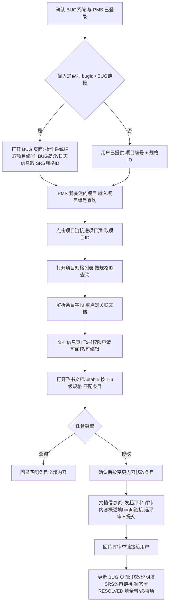

# SRS 规格查询与修改助手

围绕 PMS「项目规格」条目与关联的飞书文档，完成 SRS 规格的定位、查询、修改与评审提交。全程在集成浏览器中操作。

## 系统与登录

| 系统 | URL | 用途 |
|---|---|---|
| BUG 系统 | http://bugs.ruijie.com.cn/ | 由 bugId 解析项目编号与 SRS 规格ID |
| PMS 系统 | http://pms.ruijie.com.cn/ | 检索规格条目、申请飞书权限、发起评审 |

## 何时使用

1. **BUG 定位**：给了 bugId 或 BUG 链接，要查找/修改其对应的 SRS 规格。
2. **直接查询**：给了项目编号 + SRS 规格ID，要查看规格条目内容。
3. **直接修改**：给了项目编号 + SRS 规格ID + 变更内容，要修改规格并发起评审。

## 输入模式与步骤起点

| 输入 | 执行路径 |
|---|---|
| bugId / BUG 链接 | 步骤 1 → 2 → 3 → 4 → 5 → 6 |
| 项目编号 + 规格ID（查询） | 步骤 1 → 3 → 4(可阅读) → 5(查询) |
| 项目编号 + 规格ID + 变更内容 | 步骤 1 → 3 → 4(可编辑) → 5(修改+提交) → 6 |

## 完整流程

## 步骤

### 1. 确认系统登录权限

- 依次打开 http://bugs.ruijie.com.cn/ 与 http://pms.ruijie.com.cn/，判断是否落在登录页。
- 需要登录时提醒用户在集成浏览器中完成登录，**等待登录完成后**再继续；不代填账号密码。
- 两个系统均确认已登录后才进入后续步骤。

### 2. 由 bugId 获取项目编号与 SRS 规格ID（仅 BUG 定位模式）

1. 打开 BUG 页面：用户给了链接就直接打开；只给了 bugId 时拼
   `http://bugs.ruijie.com.cn/bug_switch/bug/main?bugId=<bugId>`。
2. 从 BUG 页面提取两个关键信息：
   - **项目编号**：`操作系统:` 这一栏里填写的内容。
   - **SRS 规格ID**：在 `BUG简介:` 或 `日志信息` 中获取需要修改的规格 ID
     （两处都查找；两处内容不一致时停下向用户确认，不要自行取舍）。
3. 把「项目编号 + 规格ID」回显给用户确认后，进入步骤 3。

### 3. 在 PMS 中查找 SRS 规格条目

1. 打开「我关注的项目」：
   `http://pms.ruijie.com.cn/pms/index.jhtml?taskType=open_url&taskTarget=OPEN_URL&taskTitle=我关注的项目&taskUrl=/project/my_list.jhtml?TYPE=LITE`
2. 在项目搜索栏输入 `<项目编号>`，点击查询。
3. 点击项目栏中的项目链接，跳转到项目页（URL 形如
   `http://pms.ruijie.com.cn/pms/index.jhtml?taskType=open_url&taskTarget=OPEN_URL&taskTitle=<项目编号>&taskUrl=/project/project_index.jhtml?projectId=<项目ID>`），
   记下 **项目ID**。
4. 打开「项目规格」列表：
   `http://pms.ruijie.com.cn/pms/index.jhtml?taskType=open_url&taskTarget=OPEN_URL&taskTitle=项目规格&taskUrl=/project/project_product_standard/project_product_standard_list.jhtml?projectId=<项目ID>`
5. 在 `规格ID:` 栏输入 `<SRS规格ID>`，点击查询。
6. 读取并解析命中的条目，记录下列字段（字段名以页面为准）：

   | 字段 | 用途 |
   |---|---|
   | 规格Id | 条目唯一标识 |
   | 1级规格 ~ 6级规格 | 层级路径，步骤 5 在飞书文档中定位条目的依据 |
   | 规格库 | 所属规格库 |
   | 关联ITC编号 | 关联 ITC 用例编号 |
   | 类型 | 条目类型 |
   | AI检查结果 | AI 检查状态 |
   | 代码变化 | 代码变化标记 |
   | 关联文档 | **飞书文档入口，步骤 4/5 必用** |
   | 数据表 | 关联数据表 |
   | 关联项目需求 | 关联需求 |
   | 关联工作包 | 关联工作包 |
   | 创建时间 / 修改时间 | 时间戳 |

### 4. 飞书文档权限确认

1. 在 `关联文档` 列点击文档链接前的 `[xxx]` id 地址信息，跳转到 `文档信息` 页面。
2. 点击 `飞书权限申请`，在 `申请权限` 栏按任务类型选择后点 `保存`：
   - 查询任务 → 选 `可阅读`。
   - 修改任务 → 选 `可编辑`。
3. `可编辑` 注意：提交负责人非本人时，需**等待提交负责人审核通过**后才有编辑权限；告知用户并等待，不得跳过。
4. 权限最小化：只查询不修改时只申请 `可阅读`。

### 5. 查询、修改、提交文档内容

- **查询**：在 `文档信息` 页面点击 `打开飞书文档` 按钮跳转飞书文档 → 用条目的
  1~6 级规格逐级匹配 → 读取匹配条目的**所有内容**并回显。
- **修改**：在飞书文档中根据用户要求的变更内容修改条目。落笔前先回显
  「原文 → 拟改后」对照，经用户确认再修改。
- **提交**：回到 `文档信息` 页面 → 点击 `发起/查看评审` 进入评审表单申请页 →
  1. **评审内容概述**：必须填写关联的 bugId 链接
     （形如 `http://bugs.ruijie.com.cn/bug_switch/bug/main?bugId=<bugId>`）。
  2. **评审人员**：按项目历史评审惯例为每个必须评审角色（need=1 的角色 chip，
     如 CA/PGTTL/PGTTM/PTGTTL/PTGTTM/PSDPE）选定人员；同一人可兼任多角色，
     角色覆盖人数会累加显示，属正常现象。可调用页面函数
     `_reviewRoleUserPanelHandler.assign(entityId, role, userId, userName)` 指派。
  3. **提交**：调用 `saveReviewForm(true, 提交按钮)` 或触发提交；提交成功后页面
     可能无跳转（`Pages.updateTab` 在独立页面静默失败），不要误判失败——通过
     重新加载文档信息页确认「第 N 次评审」与新表单号（形如 `RF2026xxxxxxxx`），
     或用评审列表接口查 `reviewFormId`，评审单链接形如
     `http://pms.ruijie.com.cn/review/form/flow.jhtml?id=<reviewFormId>`。
  4. **把评审单链接发给用户**，并进入步骤 6。

### 6. 更新 BUG 页面内容并置为 RESOLVED（修改类任务必做）

SRS 修订提交评审后，回到 BUG 编辑页
`http://bugs.ruijie.com.cn/bug_switch/bug/bug_info?bugId=<bugId>`（表单 action 为
`/bug_switch/bug/bug_info_save`，「提交」按钮 id=`submitBtn`）完成两件事：

1. **更新 BUG 内容**：在「修改说明」（UEditor，全局变量 `changeMessage`）中填写
   统一模版，「是否必现」按该 BUG 的 `#repro` 字段实际值填写（必现/偶现等）：

   > **【SRS修订说明】**
   > 修订类型：SRS规格修订（产品支持列 Y→N）
   > 是否必现：<按 BUG 实际填写>
   > 修订内容：SRS规格与产品实际支持情况不一致，已在SRS文档中将对应规格的产品支持列由Y修订为N。
   > 涉及文档：<文档名>（PMSID：<各PMSID>）
   > 评审单：<RF单号>（<评审单链接>）
   > 代码影响：无代码改动，仅SRS文档修订。

   用 `changeMessage.setContent(<HTML>)` 写入；validateData 提交前会自动同步。

2. **BUG状态更新为 RESOLVED 并填全带 \* 必填项**：
   - `$('#state').combobox('setValue', '5')`（RESOLVED=stateid 5）。
   - 切换后必填字段集合（服务端定义，state=5）：
     `wbs, effectbug, closeproperty, resolvedok, savebugid, repairOrder,
     repairInfluence, testVerification, needCollect, locationResult, comPathId`，
     加上全状态必填的 `owner, belong, state, os`；DOM 中所有 `.required`
     元素（含 resolvedAnalyse/resolvedSolution/resolvedVerification/
     resolvedModuleAffect/resolvedProductAffect）也会被校验，全部要填。
   - **SRS 文档提交链接**：写入 BUG 内容/解决方案/验证字段（如评审单 RF 单号
     与 `flow.jhtml` 链接），确保测试与负责人能从 BUG 页面跳转到 SRS 评审。
   - 参考填写（SRS 修订场景，无代码改动）：
     | 字段 | 参考值 |
     |---|---|
     | effectbug（BUG引入状态） | 需求分析 |
     | closeproperty（解决方式） | 变更指标 |
     | resolvedok（是否用户接口修订） | 非用户接口修订 |
     | needCollect（一键收集信息） | 不需要 |
     | repairOrder（修订量） | 0 |
     | wbs（工作包） | 选具体功能包，勿选「遗留或delay的bug」 |
     | 发现BUG的组件 | NA（选组件+分支路径后点「关联」） |
   - 文本字段按「分析过程/解决方案/验证/影响面/根因」语义填写，写明评审单链接。
3. **提交并验证**：`validateData()` 通过后点 `submitBtn`；成功提示
   「修订BUG信息成功」且页面 2 秒后自动刷新。刷新后用
   `GET /bug_switch/bug/get_bug_info_params?bugId=<bugId>` 确认 `state=5`
   且各字段已持久化；修改说明会以日志记录（loginfoTable）形式展示。

## 踩坑与提速记忆文档（references/pitfalls.md）

- 本 skill 目录下 `references/pitfalls.md` 是**统一记忆文档**，合并「实战经验与
  已知坑」与「提速经验速查」两部分：接口地址、组件 setValue 签名、字典值、
  调试技巧与耗时基线均在其中。
- **执行前**：按当前所处步骤先查该文档对应小节（BUG 页回填、评审提交、
  bitable、browser_evaluate 规范），命中结论直接套用，不要重新试探。
- **执行中**：发现新的踩坑或提速方法，**当场追加**到该文档对应小节
  （格式：`- [YYYY-MM-DD] 内容`），并更新耗时基线表；SKILL.md 本身不沉淀细节。

## 关键规则

1. 登录拦截必须等用户完成登录，不得使用代填的默认凭据。
2. `操作系统:`、`BUG简介:`、`日志信息`、`规格ID:`、`关联文档`、`飞书权限申请`、`打开飞书文档`、`发起/查看评审` 等页面文案按原文匹配，不要凭记忆改写。
3. PMS 两个入口的 `taskUrl` 参数不同：项目搜索是 `/project/my_list.jhtml?TYPE=LITE`，规格列表是 `/project/project_product_standard/project_product_standard_list.jhtml?projectId=<项目ID>`；`项目ID` 必须取自步骤 3 的项目页跳转 URL，不要自己拼。
4. 飞书文档条目定位只认 1~6 级规格路径；层级对不上时停下向用户确认，不要猜近似条目。
5. 修改类任务以「评审单链接已发给用户」且「BUG 页面已更新（修改说明含 SRS 评审
   链接、状态已置 RESOLVED、带 \* 必填项已填全）并经服务端读回确认」为完成标志；
   缺一不算完成。
6. 不在执行过程中保存或回显明文账号密码；优先复用已登录的集成浏览器会话。
