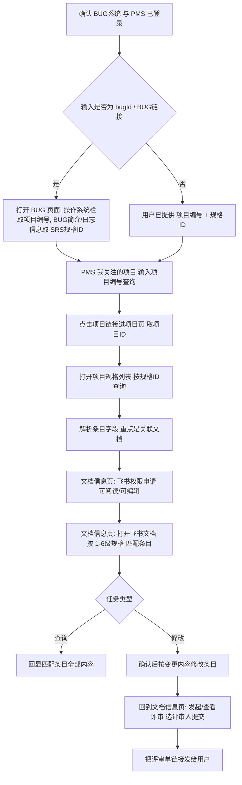

# SRS 规格查询与修改助手

围绕 PMS「项目规格」条目与关联的飞书文档，完成 SRS 规格的定位、查询、修改与评审提交。全程在集成浏览器中操作。

## 系统与登录

| 系统 | URL | 用途 |
|---|---|---|
| BUG 系统 | http://bugs.ruijie.com.cn/ | 由 bugId 解析项目编号与 SRS 规格ID |
| PMS 系统 | http://pms.ruijie.com.cn/ | 检索规格条目、申请飞书权限、发起评审 |

## 何时使用

1. **BUG 定位**：给了 bugId 或 BUG 链接，要查找/修改其对应的 SRS 规格。
2. **直接查询**：给了项目编号 + SRS 规格ID，要查看规格条目内容。
3. **直接修改**：给了项目编号 + SRS 规格ID + 变更内容，要修改规格并发起评审。

## 输入模式与步骤起点

| 输入 | 执行路径 |
|---|---|
| bugId / BUG 链接 | 步骤 1 → 2 → 3 → 4 → 5 |
| 项目编号 + 规格ID（查询） | 步骤 1 → 3 → 4(可阅读) → 5(查询) |
| 项目编号 + 规格ID + 变更内容 | 步骤 1 → 3 → 4(可编辑) → 5(修改+提交) |

## 完整流程

## 步骤

### 1. 确认系统登录权限

- 依次打开 http://bugs.ruijie.com.cn/ 与 http://pms.ruijie.com.cn/，判断是否落在登录页。
- 需要登录时提醒用户在集成浏览器中完成登录，**等待登录完成后**再继续；不代填账号密码。
- 两个系统均确认已登录后才进入后续步骤。

### 2. 由 bugId 获取项目编号与 SRS 规格ID（仅 BUG 定位模式）

1. 打开 BUG 页面：用户给了链接就直接打开；只给了 bugId 时拼
   `http://bugs.ruijie.com.cn/bug_switch/bug/main?bugId=<bugId>`。
2. 从 BUG 页面提取两个关键信息：
   - **项目编号**：`操作系统:` 这一栏里填写的内容。
   - **SRS 规格ID**：在 `BUG简介:` 或 `日志信息` 中获取需要修改的规格 ID
     （两处都查找；两处内容不一致时停下向用户确认，不要自行取舍）。
3. 把「项目编号 + 规格ID」回显给用户确认后，进入步骤 3。

### 3. 在 PMS 中查找 SRS 规格条目

1. 打开「我关注的项目」：
   `http://pms.ruijie.com.cn/pms/index.jhtml?taskType=open_url&taskTarget=OPEN_URL&taskTitle=我关注的项目&taskUrl=/project/my_list.jhtml?TYPE=LITE`
2. 在项目搜索栏输入 `<项目编号>`，点击查询。
3. 点击项目栏中的项目链接，跳转到项目页（URL 形如
   `http://pms.ruijie.com.cn/pms/index.jhtml?taskType=open_url&taskTarget=OPEN_URL&taskTitle=<项目编号>&taskUrl=/project/project_index.jhtml?projectId=<项目ID>`），
   记下 **项目ID**。
4. 打开「项目规格」列表：
   `http://pms.ruijie.com.cn/pms/index.jhtml?taskType=open_url&taskTarget=OPEN_URL&taskTitle=项目规格&taskUrl=/project/project_product_standard/project_product_standard_list.jhtml?projectId=<项目ID>`
5. 在 `规格ID:` 栏输入 `<SRS规格ID>`，点击查询。
6. 读取并解析命中的条目，记录下列字段（字段名以页面为准）：

   | 字段 | 用途 |
   |---|---|
   | 规格Id | 条目唯一标识 |
   | 1级规格 ~ 6级规格 | 层级路径，步骤 5 在飞书文档中定位条目的依据 |
   | 规格库 | 所属规格库 |
   | 关联ITC编号 | 关联 ITC 用例编号 |
   | 类型 | 条目类型 |
   | AI检查结果 | AI 检查状态 |
   | 代码变化 | 代码变化标记 |
   | 关联文档 | **飞书文档入口，步骤 4/5 必用** |
   | 数据表 | 关联数据表 |
   | 关联项目需求 | 关联需求 |
   | 关联工作包 | 关联工作包 |
   | 创建时间 / 修改时间 | 时间戳 |

### 4. 飞书文档权限确认

1. 在 `关联文档` 列点击文档链接前的 `[xxx]` id 地址信息，跳转到 `文档信息` 页面。
2. 点击 `飞书权限申请`，在 `申请权限` 栏按任务类型选择后点 `保存`：
   - 查询任务 → 选 `可阅读`。
   - 修改任务 → 选 `可编辑`。
3. `可编辑` 注意：提交负责人非本人时，需**等待提交负责人审核通过**后才有编辑权限；告知用户并等待，不得跳过。
4. 权限最小化：只查询不修改时只申请 `可阅读`。

### 5. 查询、修改、提交文档内容

- **查询**：在 `文档信息` 页面点击 `打开飞书文档` 按钮跳转飞书文档 → 用条目的
  1~6 级规格逐级匹配 → 读取匹配条目的**所有内容**并回显。
- **修改**：在飞书文档中根据用户要求的变更内容修改条目。落笔前先回显
  「原文 → 拟改后」对照，经用户确认再修改。
- **提交**：回到 `文档信息` 页面 → 点击 `发起/查看评审` → 按要求选定评审人员 →
  点击提交保存 → **把评审单链接发给用户**。

## 关键规则

1. 登录拦截必须等用户完成登录，不得使用代填的默认凭据。
2. `操作系统:`、`BUG简介:`、`日志信息`、`规格ID:`、`关联文档`、`飞书权限申请`、`打开飞书文档`、`发起/查看评审` 等页面文案按原文匹配，不要凭记忆改写。
3. PMS 两个入口的 `taskUrl` 参数不同：项目搜索是 `/project/my_list.jhtml?TYPE=LITE`，规格列表是 `/project/project_product_standard/project_product_standard_list.jhtml?projectId=<项目ID>`；`项目ID` 必须取自步骤 3 的项目页跳转 URL，不要自己拼。
4. 飞书文档条目定位只认 1~6 级规格路径；层级对不上时停下向用户确认，不要猜近似条目。
5. 修改类任务以「评审单链接已发给用户」为完成标志，未发起评审不算完成。
6. 不在执行过程中保存或回显明文账号密码；优先复用已登录的集成浏览器会话。
